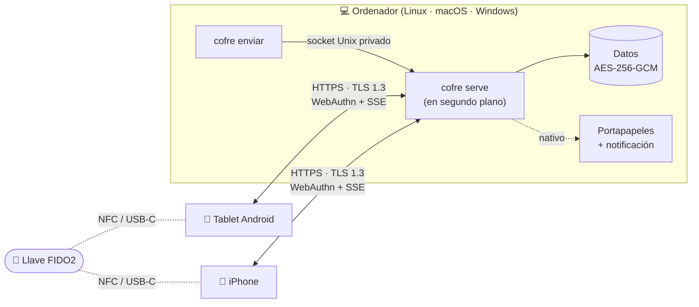

<h1 align="center">
  <br>
  Cofre
</h1>

<p align="center">
  Tu propio "AirDrop" para la red de casa: comparte archivos, fotos y textos entre
  Linux, macOS, Windows, Android e iPhone, <b>protegido con una llave de seguridad FIDO2</b>
  y cifrado en la red y en el disco.
</p>

<p align="center">
  <a href="https://github.com/RedShenlong/cofre/actions/workflows/ci.yml"></a>
  
  
  
  
  
  <a href="LICENSE"></a>
</p>

<p align="center">
  
  &nbsp;
  
  &nbsp;
  
</p>

---

## ¿Por qué?

Herramientas como LocalSend envían archivos **de un dispositivo a otro**, de uno en uno.
Si generas un PDF en el portátil y lo quieres en la tablet **y** en el móvil, toca enviarlo
dos veces o acabar mandándotelo por WhatsApp.

**Cofre** cambia el enfoque: tu ordenador (Linux, macOS o Windows) hace de **cofre compartido** en tu red local.
Subes algo una vez, desde la terminal o desde cualquier navegador, y aparece **al instante en
todos tus dispositivos**. Para entrar hace falta tu llave física (YubiKey, Google Titan…), así
que nadie más de tu wifi puede ver nada.

## Características

- ⚡ **Tiempo real**: lo que subes aparece al momento en todos los dispositivos conectados (Server-Sent Events).
- 🔑 **Login con llave FIDO2/WebAuthn**: sin contraseñas, por NFC o USB-C. Admite varias llaves (titular y repuesto).
- 🔒 **Cifrado en todas partes**: TLS 1.3 en la red y AES-256-GCM en el disco, incluidos los nombres de archivo.
- 📋 **Portapapeles compartido**: lo que envías desde el móvil se copia solo en el ordenador, con notificación; en los móviles queda a un toque.
- 🖥️ **CLI** con barra de progreso: `cofre enviar apuntes.pdf`.
- 📱 **App instalable (PWA)**: se añade a la pantalla de inicio del iPhone y de Android como una app más.
- 🖱️ **Arrastrar y soltar**, pegar capturas con <kbd>Ctrl</kbd>+<kbd>V</kbd>, textos con <kbd>Ctrl</kbd>+<kbd>Enter</kbd>.
- 📌 **Autolimpieza**: lo antiguo se borra solo (configurable), salvo lo que fijes.
- 👥 **Gestión de dispositivos**: ve qué dispositivos tienen sesión y expulsa cualquiera al instante.
- 🪶 **Ligero**: un único binario en Go sin dependencias externas. En reposo usa unos 20 MB de RAM y prácticamente nada de CPU.
- 🖥️ **Multiplataforma**: el servidor funciona en Linux, macOS y Windows, cada uno con su arranque automático, portapapeles y notificaciones nativos. *macOS y Windows aún sin probar en equipos reales.*

<p align="center">
  
</p>

## Cómo funciona



- El ordenador ejecuta `cofre serve` en segundo plano y sirve la web por HTTPS en el puerto `8443`. En Linux lo arranca systemd, en macOS launchd y en Windows el Programador de tareas.
- Los demás dispositivos lo encuentran por **mDNS** en `https://<nombre-del-ordenador>.local:8443`. No hace falta saber la IP.
- La CLI habla con el servidor por un **socket Unix** privado, así que no necesita llave.

## Requisitos

| | |
|---|---|
| **Servidor** | **Linux** con systemd y Avahi ✅ · **macOS** 12 o superior 🧪 · **Windows** 10 (1803+) / 11 🧪 |
| **Go** | 1.26 o superior, solo para compilar. |
| **Llave** | Cualquier llave FIDO2: Google Titan, YubiKey, SoloKey, Nitrokey… |
| **Clientes** | Android con Chrome · iPhone/iPad con Safari · cualquier navegador moderno en escritorio. |
| **Red** | Todos los dispositivos en la misma red local. |

> [!WARNING]
> **Las versiones de macOS y Windows todavía no se han probado en equipos reales.**
> La de Linux es la que se usa a diario (Arch / CachyOS con Hyprland). Las de macOS y Windows
> comparten el mismo núcleo, compilan sin errores y la CI de GitHub ejecuta en ellas las pruebas
> y una instalación de prueba. Aun así, puede haber fallos en el instalador, en el portapapeles o
> en las notificaciones. Si las pruebas y algo falla, [abre un issue](https://github.com/RedShenlong/cofre/issues).

## Instalación

Primero instala el servidor en el ordenador que hará de cofre (pasos 1 y 2, según tu sistema).
Los pasos 3, 4 y 5 son iguales para todos.

### 1. Instalar el servidor

<details open>
<summary><b>🐧 Linux</b> · ✅ probado</summary>

**Necesitas:** Go, Avahi (para el nombre `.local`) y, si quieres el portapapeles compartido, `wl-clipboard`.

```bash
# Arch / CachyOS / Manjaro
sudo pacman -S go avahi wl-clipboard libnotify
# Debian / Ubuntu
sudo apt install golang avahi-daemon wl-clipboard libnotify-bin

sudo systemctl enable --now avahi-daemon
```

**Instala Cofre** (sin `sudo`):

```bash
git clone https://github.com/RedShenlong/cofre.git
cd cofre
./install.sh
```

El instalador hace esto:
- Compila el binario y lo copia en `~/.local/bin/cofre`.
- Instala y arranca el servicio de usuario `cofre.service`, que arrancará solo cada vez que inicies sesión.
- Muestra tu dirección (`https://<host>.local:8443`) y las reglas de firewall que necesitas.

**Firewall.** Con `ufw`, abre los puertos una sola vez y sirve para cualquier wifi:

```bash
sudo ufw allow 8443/tcp   # Cofre
sudo ufw allow 5353/udp   # mDNS (para encontrar <host>.local)
```

No hace falta limitar la subred en el firewall: **Cofre solo acepta conexiones de la red a la
que estés conectado en ese momento** (más el propio ordenador) y corta cualquier otra antes de
empezar TLS. Si cambias de wifi, el filtro cambia solo.

**Confía en el certificado en este ordenador**, para registrar tu llave desde su navegador
(Chrome, Chromium o Brave):

```bash
certutil -d sql:$HOME/.pki/nssdb -A -t "C,," -n "Cofre CA" -i ~/.local/share/cofre/tls/cofre-ca.crt
```

| | |
|---|---|
| Datos | `~/.local/share/cofre` |
| Log | `journalctl --user -u cofre -f` |
| Reiniciar | `systemctl --user restart cofre` |
| Desinstalar | `./uninstall.sh` (añade `--purge` para borrar también los datos) |

</details>

<details>
<summary><b>🍎 macOS</b> · 🧪 sin probar aún en equipos reales</summary>

**Necesitas Go** ([Homebrew](https://brew.sh)):

```bash
brew install go
```

**Instala Cofre** (sin `sudo`):

```bash
git clone https://github.com/RedShenlong/cofre.git
cd cofre
./install-macos.sh
```

El instalador hace esto:
- Compila el binario y lo copia en `~/.local/bin/cofre`. Si esa carpeta no está en tu `PATH`, te dice cómo añadirla.
- Crea un **agente de launchd** (`com.redshenlong.cofre`) que arranca Cofre al iniciar sesión.
- Muestra tu dirección. macOS publica el equipo por Bonjour con su *nombre local*, que puedes ver en **Ajustes del Sistema → General → Compartir**.

**Firewall.** Si tienes el firewall de macOS activado, la primera vez te preguntará si `cofre`
puede aceptar conexiones entrantes. Pulsa **Permitir**.

**Confía en el certificado en este Mac**, para Safari y Chrome. Te pedirá la contraseña:

```bash
security add-trusted-cert -r trustRoot -k ~/Library/Keychains/login.keychain-db \
  ~/Library/Application\ Support/Cofre/tls/cofre-ca.crt
```

| | |
|---|---|
| Datos | `~/Library/Application Support/Cofre` |
| Log | `tail -f ~/Library/Logs/Cofre/cofre.log` |
| Reiniciar | `launchctl kickstart -k gui/$(id -u)/com.redshenlong.cofre` |
| Desinstalar | `./uninstall-macos.sh` (añade `--purge` para borrar también los datos) |

</details>

<details>
<summary><b>🪟 Windows 10 / 11</b> · 🧪 sin probar aún en equipos reales</summary>

**Necesitas Go y Git.** En PowerShell:

```powershell
winget install GoLang.Go Git.Git
```

Cierra y vuelve a abrir PowerShell para que se carguen. Después **instala Cofre**:

```powershell
git clone https://github.com/RedShenlong/cofre.git
cd cofre
powershell -ExecutionPolicy Bypass -File .\install-windows.ps1
```

El instalador hace esto:
- Compila dos programas en `%LOCALAPPDATA%\Programs\Cofre` y añade esa carpeta a tu `PATH`:
  - `cofre.exe`: los comandos (`cofre enviar`, `cofre registrar`…).
  - `cofre-servidor.exe`: el servidor en segundo plano, **sin ventana**.
- Crea una tarea del **Programador de tareas** que arranca el servidor al iniciar sesión, también con batería.
- Abre el puerto `8443` en el firewall **solo para redes privadas**. Windows te pedirá permiso de administrador una vez.
- Te ofrece **confiar en el certificado en este PC**, para Chrome y Edge. Windows mostrará una advertencia de seguridad: pulsa **Sí**.

> ⚠️ **Tu wifi tiene que estar marcada como red privada:** **Configuración → Red e Internet →
> Wi-Fi → (tu red) → Tipo de perfil de red → Privada**. En una red "pública", Windows bloquea
> tanto Cofre como el nombre `.local`.

Abre una terminal **nueva** para usar el comando `cofre`.

| | |
|---|---|
| Datos | `%LOCALAPPDATA%\Cofre` |
| Log | `Get-Content $env:LOCALAPPDATA\Cofre\cofre.log -Wait` |
| Reiniciar | `Stop-ScheduledTask Cofre; Start-ScheduledTask Cofre` |
| Desinstalar | `powershell -ExecutionPolicy Bypass -File .\uninstall-windows.ps1` (añade `-Purge` para borrar también los datos) |

</details>

### 2. Comprobar que funciona

```bash
cofre estado
# ✓ Cofre en marcha en https://<host>.local:8443
```

### 3. Instalar el certificado en tus móviles y tablets

Cofre genera **su propia autoridad de certificación (CA)**, que solo es válida para tu
ordenador. Se instala **una vez** en cada dispositivo. Para ver la huella y las rutas:

```bash
cofre ca
```

<details>
<summary><b>📲 Android (probado en Samsung Galaxy Tab)</b></summary>

1. Envía `cofre-ca.crt` a la tablet con **LocalSend**, que va cifrado. La ruta la muestra `cofre ca`. También puedes descargarlo en Chrome desde `https://<host>.local:8443/ca/cofre-ca.crt`.
2. **Ajustes → Seguridad y privacidad → Más ajustes de seguridad → Instalar desde almacenamiento del dispositivo → Certificado de CA**.
3. Toca **Instalar de todos modos**, desbloquea con tu PIN o patrón y elige `cofre-ca.crt`.
4. Comprueba la huella en **Ver certificados de seguridad → Usuario → Cofre CA**. Tiene que coincidir con la que muestra `cofre ca`.

Usa **Chrome**. Samsung Internet no gestiona bien las llaves de seguridad.
</details>

<details>
<summary><b>📱 iPhone / iPad</b></summary>

1. Abre **Safari** (tiene que ser Safari) y ve a `https://<host>.local:8443/ca/cofre-ca.crt`.
2. Saldrá el aviso "Esta conexión no es privada", que es normal la primera vez. Toca **Mostrar detalles → visitar este sitio web**.
3. Cuando pregunte si quieres permitir la descarga del perfil, toca **Permitir**.
4. **Ajustes → Perfil descargado → Instalar** e introduce el código del iPhone.
5. ⚠️ **No te saltes este paso:** **Ajustes → General → Información → Ajustes de confianza de certificados** y activa **Cofre CA**.
6. Comprueba la huella en **Ajustes → General → VPN y gestión de dispositivos → Cofre CA → Más detalles → SHA-256**.
</details>

<details>
<summary><b>💻 Otros ordenadores de casa (como clientes)</b></summary>

Basta con confiar en `cofre-ca.crt` en su navegador:
- **Windows (Chrome/Edge):** doble clic en el archivo → **Instalar certificado → Usuario actual → Entidades de certificación raíz de confianza**.
- **macOS (Safari/Chrome):** doble clic → se abre Acceso a Llaveros → abre "Cofre CA" → **Confiar → Usar siempre**.
- **Linux (Chrome/Chromium):** el comando `certutil` del apartado de Linux.
- **Firefox (cualquier sistema):** **Ajustes → Privacidad y seguridad → Certificados → Ver certificados → Autoridades → Importar**.
</details>

**¿Está bien instalado?** Abre `https://<host>.local:8443`. Si la página carga **sin ningún aviso**,
el certificado está bien.

### 4. Registrar tu llave (desde el ordenador servidor)

Por seguridad, la llave **solo se puede registrar desde el propio ordenador donde está Cofre**:

```bash
cofre registrar
```

Se abre su navegador. Ponle nombre a la llave, pulsa **Registrar llave** y tócala. Ese
navegador también necesita confiar en el certificado (ver el paso 1 de tu sistema).

La llave se registra **una vez** y sirve en **todos** tus dispositivos. En el móvil y en la tablet
solo tienes que tocar **"Entrar con mi llave"**.

> Cofre **no guarda nada dentro de la llave**: no ocupa espacio de passkeys y no toca las que
> ya tengas. Te recomiendo registrar también una **llave de repuesto** desde ⚙️ Ajustes.

### 5. Añadirlo a la pantalla de inicio

- **iPhone (Safari):** Compartir → **Añadir a pantalla de inicio**. La app de inicio no comparte sesión con Safari, así que la primera vez tendrás que entrar con la llave otra vez.
- **Android (Chrome):** ⋮ → **Añadir a pantalla de inicio → Instalar**.

<p align="center">
  
</p>

## Uso

### Desde la terminal del ordenador

```bash
cofre enviar apuntes.pdf soluciones.pdf      # uno o varios archivos, con barra de progreso
cofre enviar -t "nos vemos a las 5"           # un texto
git diff | cofre enviar -                     # lo que llegue por la entrada estándar
cofre estado                                  # comprobar que el servidor funciona
```

### Desde cualquier navegador

- **Archivos:** arrástralos a la ventana, usa el botón **Archivos** o pega una captura con <kbd>Ctrl</kbd>+<kbd>V</kbd>.
- **Textos:** escríbelos y envíalos con **Enviar** o <kbd>Ctrl</kbd>+<kbd>Enter</kbd>.
- **Acciones de cada elemento:** **Abrir**, **Guardar**, **Copiar** (textos e imágenes), **Fijar** (📌, no se borra solo) y **Borrar**.

### Portapapeles compartido

| Dispositivo | Qué pasa cuando llega un texto o una imagen desde otro dispositivo |
|---|---|
| 💻 Ordenador servidor | Se copia **automáticamente**, con notificación, aunque no tengas la web abierta. Linux usa `wl-copy` (Wayland), macOS `pbcopy`/AppleScript y Windows PowerShell. |
| 📲 Android | Se copia solo si tienes Cofre abierto en pantalla. Si no, aparece un aviso para copiarlo con un toque. |
| 📱 iPhone | iOS exige un toque: aparece un aviso **"Copiar"** al abrir la app. |

Se activa y desactiva en ⚙️ Ajustes → Preferencias.

### Comandos

| Comando | Descripción |
|---|---|
| `cofre serve [opciones]` | Arranca el servidor. Normalmente lo lanza systemd. |
| `cofre enviar ARCHIVO…` / `-t "texto"` / `-` | Sube archivos o texto. |
| `cofre registrar` | Registra una llave desde el ordenador servidor (abre su navegador). |
| `cofre reiniciar-llaves` | Borra todas las llaves y sesiones, por si pierdes tu llave. Tus archivos se conservan. |
| `cofre ca` | Muestra el certificado, su huella y cómo instalarlo. |
| `cofre estado` | Comprueba que el servidor está en marcha. |

**Opciones de `cofre serve`:**

| Opción | Por defecto | Descripción |
|---|---|---|
| `-host` | `<hostname>.local` | Nombre con el que te encuentran los dispositivos. |
| `-port` | `8443` | Puerto HTTPS. |
| `-addr` | *(todas)* | IP en la que escuchar. |
| `-data` | `~/.local/share/cofre` | Carpeta de datos (cifrados). |
| `-max-mb` | `16384` | Tamaño máximo de subida **desde el navegador**. La CLI no tiene límite. |

Para cambiarlas, edita `ExecStart` con `systemctl --user edit --full cofre`.

## Seguridad

Cofre está pensado para que **alguien conectado a tu misma wifi no pueda ver ni tocar nada**.

### En la red

| Amenaza | Protección |
|---|---|
| Espiar el tráfico | Todo va por **TLS 1.3**. No hay HTTP ni versiones antiguas de TLS. |
| Suplantar al servidor (MITM) | Tus dispositivos solo confían en tu CA. Su clave privada **se genera en memoria y se destruye** nada más firmar el certificado, así que no existe en ningún disco. |
| Usar tu CA para espiar otras webs | La CA lleva *Name Constraints* **críticas**: solo puede firmar certificados para `<host>.local`, y se excluyen todas las IPs. |
| Entrar sin permiso | **WebAuthn/FIDO2**. El reto es aleatorio y de un solo uso, va ligado al origen exacto, se detectan llaves clonadas y se pide el PIN de la llave si lo tiene. Solo se aceptan llaves físicas (`cross-platform`). |
| Robar la sesión | Cookie `__Host-`, `Secure`, `HttpOnly` y `SameSite=Strict`. En el servidor solo se guarda su hash SHA-256. Las sesiones caducan y se pueden revocar. |
| CSRF / DNS rebinding | Se comprueban las cabeceras `Origin` y `Host` en cada petición. |
| XSS / contenido malicioso | La página tiene una CSP estricta (`script-src 'self'`). Los archivos subidos se sirven en *sandbox* o como descarga, con `nosniff`. |
| Registrar una llave ajena | Las llaves solo se registran **desde el propio ordenador servidor**. `cofre registrar` genera un secreto de **256 bits**, de un solo uso y que caduca en 10 minutos. Viaja en el fragmento de la URL (`#`), así que nunca se envía en la dirección ni aparece en el historial. Además, el servidor rechaza cualquier registro que no venga de una IP del propio ordenador. Con sesión iniciada se pueden añadir llaves de repuesto desde Ajustes. |

### En el disco

- Archivos, textos, **nombres de archivo**, llaves registradas y sesiones se guardan cifrados con **AES-256-GCM**.
- Cada archivo usa su propia clave, derivada con HKDF-SHA256.
- Los archivos se cifran en **trozos autenticados de 64 KiB**. Si alguien modifica, reordena o recorta un trozo, se detecta. Además así se puede buscar dentro de un archivo (*Range*) sin descifrarlo entero.
- La clave maestra está en `master.key`, con permisos `0600`. Protege los datos si alguien copia la carpeta sin esa clave. Para protegerte también del robo del ordenador, usa además **cifrado de disco completo** (LUKS, FileVault o BitLocker).

### En el sistema

- En Linux, el servicio de systemd está aislado (`ProtectSystem=strict`, `NoNewPrivileges`, `MemoryDenyWriteExecute`…). Solo puede escribir en su carpeta de datos y en su socket.
- En todos los sistemas, Cofre se ejecuta con tu usuario normal, nunca como administrador.
- La CLI usa un socket Unix privado: con permisos `0600` en Linux y macOS, y dentro de `%LOCALAPPDATA%` (que solo es accesible por tu usuario) en Windows. Así que solo tu usuario puede usarla.
- Los enlaces de abrir y descargar llevan una firma HMAC y caducan a los 15 minutos.

¿Has encontrado un fallo de seguridad? Mira [SECURITY.md](SECURITY.md).

## Solución de problemas

<details>
<summary><b>"Esta conexión no es privada" en un dispositivo</b></summary>

- **iPhone:** casi siempre falta activar la confianza en **Ajustes → General → Información → Ajustes de confianza de certificados**.
- **Android:** comprueba que lo instalaste como **Certificado de CA**, no como certificado de usuario ni de VPN.
- Abre siempre `https://<host>.local:8443` y **nunca la IP**. El certificado y las llaves van ligados al nombre.
</details>

<details>
<summary><b>La página no carga en el móvil o la tablet</b></summary>

- Comprueba que el dispositivo está en la misma wifi y que `systemctl --user status cofre` está activo.
- Revisa el firewall: hay que abrir el puerto `8443/tcp` y también `5353/udp` (mDNS).
- Algunas redes públicas (eduroam, hoteles, cafeterías) aíslan a los dispositivos entre sí y
  no hay forma de saltarlo. Comparte internet desde el móvil y conecta el ordenador a esa red.
- Comprueba que Avahi publica el nombre: `avahi-resolve -n <host>.local`.
</details>

<details>
<summary><b>"Las llaves solo se pueden registrar desde el propio ordenador" / "Enlace no válido"</b></summary>

Ejecuta `cofre registrar` **en el ordenador servidor** y usa el navegador que se abre ahí. El enlace vale
una sola vez y caduca a los 10 minutos. Si se ha caducado, vuelve a ejecutar el comando.
</details>

<details>
<summary><b>He perdido mi llave</b></summary>

Si tienes una llave de repuesto registrada, entra con ella y borra la perdida en ⚙️ Ajustes.
Si no tienes ninguna, ejecuta en el ordenador servidor:
```bash
cofre reiniciar-llaves   # borra todas las llaves y sesiones; tus archivos se conservan
cofre registrar          # registra la nueva
```
</details>

<details>
<summary><b>"La llave no es válida"</b></summary>

Mira el motivo exacto en `journalctl --user -u cofre -n 20`. Las llaves registradas para un
nombre (`<host>.local`) solo valen para ese nombre. Si cambias el nombre del ordenador, tendrás
que volver a registrarlas.
</details>

<details>
<summary><b>No se copia nada en el portapapeles del ordenador</b></summary>

- **Linux:** el servicio necesita las variables de tu sesión gráfica y el paquete `wl-clipboard`:
  ```bash
  systemctl --user import-environment WAYLAND_DISPLAY
  systemctl --user restart cofre
  ```
- **macOS:** la primera vez puede pedir permiso para mostrar notificaciones (Script Editor/osascript). Acéptalo.
- **Windows:** comprueba en el log (`%LOCALAPPDATA%\Cofre\cofre.log`) si PowerShell dio algún error.
</details>

<details>
<summary><b>Windows: los móviles no encuentran <code>&lt;pc&gt;.local</code></b></summary>

- Asegúrate de que la wifi está como **red privada**.
- Comprueba que la regla "Cofre (red privada)" existe en el **Firewall de Windows Defender**.
- Algunas versiones de Windows no anuncian su nombre por mDNS a otros dispositivos. En ese caso, instala
  [Bonjour Print Services de Apple](https://support.apple.com/kb/DL999), que añade un anunciador mDNS
  completo, y reinicia.
</details>

<details>
<summary><b>macOS: los móviles no encuentran <code>&lt;mac&gt;.local</code></b></summary>

El nombre que anuncia macOS es el de **Ajustes del Sistema → General → Compartir → Nombre local**.
Cofre lo detecta solo, pero si lo cambias después, reinstala para regenerar el certificado.
</details>

## Desarrollo

```bash
make test     # pruebas (con detector de carreras)
make vet      # go vet + gofmt
make build    # compila ./cofre
make cross    # compila para Linux, macOS y Windows (amd64 y arm64) en dist/
```

Las pruebas incluyen un **flujo completo con una llave FIDO2 simulada por software**: alta, login,
subida y descarga. También comprueban que se rechazan las llaves falsas, la reutilización de un
reto, las sesiones revocadas, los archivos manipulados y los registros desde otra IP de la red.

```
.
├── main.go          CLI y arranque del servidor
├── server.go        HTTP, API, WebAuthn y tiempo real (SSE)
├── store.go         Estado y almacenamiento cifrado
├── crypto.go        AES-256-GCM por trozos y HKDF
├── tlsca.go         CA propia con Name Constraints
├── clipboard.go     Portapapeles compartido (genérico)
├── platform_*.go    Lo específico de cada sistema: linux, darwin (macOS), windows
├── progress.go      Barra de progreso de la CLI
├── icons.go         Iconos PNG de la PWA
├── web/             Interfaz (HTML + CSS + JS sin dependencias)
├── cofre.service    Unidad de systemd (Linux, aislada)
├── install.sh       Instalador de Linux
├── install-macos.sh Instalador de macOS (launchd)
└── install-windows.ps1  Instalador de Windows (Programador de tareas)
```

### Desinstalar

| Sistema | Comando |
|---|---|
| Linux | `./uninstall.sh` (`--purge` borra también los datos) |
| macOS | `./uninstall-macos.sh` (`--purge` borra también los datos) |
| Windows | `powershell -ExecutionPolicy Bypass -File .\uninstall-windows.ps1` (`-Purge` borra también los datos) |

## Licencia

[MIT](LICENSE) © 2026 RedShenlong
